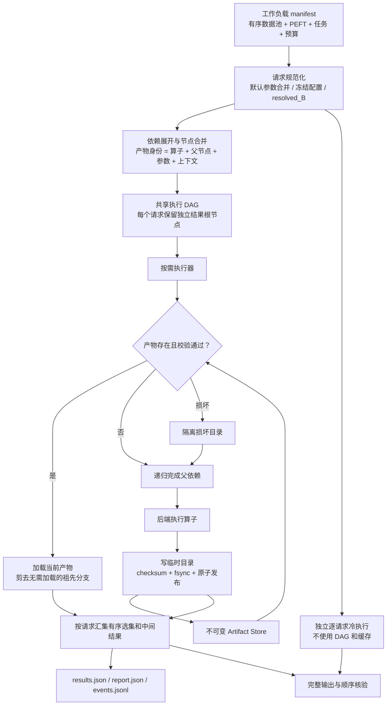
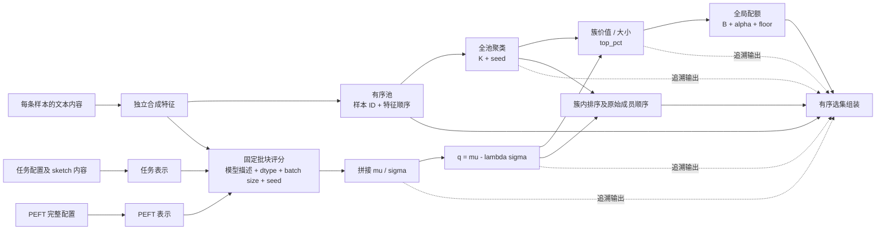

# 基本骨架的实现与架构

> 实现日期：2026-10-12。此文描述当前已运行的代码；[研究方案](peft_reuse_execution_research_plan.md)描述完整目标。当前项目没有初始化 Git。

## 1. 实现边界

| 能力 | 当前状态 | 证据/限制 |
|---|---|---|
| 请求规范化、预算解析 | 已实现 | 明确 count/fraction，拒绝未知执行/选择字段、重复 ID、非有限数值 |
| 内容身份及依赖图 | 已实现 | 内容、父节点顺序、参数、算子版本、代码与数值环境摘要 |
| 跨请求节点合并 | 已实现 | 同一批次按产物身份去重 |
| 固定评分批块复用 | 已实现于合成后端 | 追加时旧尾块变化必须重算 |
| 全池聚类及全局配额 | 已实现于合成后端 | 聚类为简单 k-means；配额调用冻结的原函数 |
| 原子缓存、校验、恢复 | 已实现 | POSIX 文件锁，单写者；不做分布式协调 |
| 独立冷执行核验 | 已实现于合成后端 | 不调用 planner/store；共享基础数值算子，并使用原始 pick 函数 |
| PCU 模型接入与等价证明 | 待实现 | 不能由合成后端测试推出真实 PCU 等价 |
| 动态成本规划、容量策略 | 待实现 | 当前策略：合法缓存全部复用，未命中全部物化 |
| GPU 时间、峰值内存、下游训练 | 待实现 | 当前记录 CPU 流程墙钟和文件提交量 |
| 研究创新与性能结论 | 待实验 | 不能把基础设施完整度当作创新证据 |

## 2. 总体执行架构



上图中的冷执行只在 `verify`、`run --verify` 或 `demo` 中运行。它的成本单独记录，并包含在带核验的命令总墙钟中。生产性能实验必须清楚标注是否包含核验。

共享执行器为需求驱动的深度优先执行，保持依赖拓扑约束。一个已经校验通过的根结果可以直接返回，不必重新打开所有祖先文件。每个已执行或已加载节点在同一批次中只处理一次。

## 3. 选数依赖图



以样例的 16 条数据、批大小 4、2 个 PEFT、2 个任务、3 个预算为例：

- 全池聚类：1 个节点。
- PEFT—任务组合：4 组，每组 4 个评分批块，总共 16 个评分节点。
- 质量、统计、排序：各 4 个节点。
- 配额、结果：各 12 个节点。
- 总计 78 个不同节点；逐请求展开为 360 个节点，合并 282 个。

这些是当前固定示例的结构计数，不是墙钟加速比。结果的 JSON 导出包含计划、所有算子、产物身份和父节点；`plan.mmd` 可用 Mermaid 渲染。

## 4. 请求格式与参数解析

完整示例见 [workload.json](../examples/workload.json)。最小形态：

```json
{
  "schema_version": 1,
  "pool": [
    {"id": "s1", "text": "Instruction and answer A"},
    {"id": "s2", "text": "Instruction and answer B"}
  ],
  "defaults": {
    "peft": {"family": "lora", "rank": 8},
    "task": {"name": "demo", "sketch": ["Task content"]},
    "model": {"name": "synthetic-scorer", "revision": "demo-v1"}
  },
  "requests": [
    {"id": "one-example", "budget": {"count": 1}},
    {"id": "whole-pool", "budget": {"fraction": 1.0}}
  ]
}
```

解析规则：

1. `pool` 在一个 manifest 内共享；不同 manifest 可使用同一缓存，验证追加、修改、删除、重排。
2. `execution` 和 `selection`：内置默认值 → manifest defaults → 请求覆盖，逐字段覆盖。
3. `peft/task/model`：请求中提供时替换整个对象，避免隐式混合不同配置。合成后端把完整 JSON 内容纳入身份。
4. 预算必须且只能使用 `count` 或 `fraction`；比例按 `floor(N × fraction)` 解析，允许解析为 0；计数范围为 `[0, N]`。`fraction: 1.0` 是全量，`count: 1` 是一条。
5. 预算不同表达但解析为同一 B 时可共享结果产物；每个请求仍保留独立的 ID 和原始预算记录。
6. 当前池格式只接受 ID 与 text。真实接入时应明确 instruction、response、metadata 哪些内容影响特征，并升级 schema/算子契约。

合成后端中的 `model.revision` 是合成函数的输入，**不是读取真实 checkpoint 后得到的内容摘要**。真实后端必须主动读取模型文件/权重快照计算摘要，不能把路径或用户填写的 revision 字符串当作权重身份。

## 5. 产物身份和失效边界

`ArtifactSpec` 是冻结数据类。参数和上下文先规范化为 JSON 字符串，避免请求传入的可变字典在后续被修改。身份由 SHA-256 计算：

```text
key = SHA256(canonical_json({
  operator, version, ordered_parent_keys, effective_params, execution_context
}))
```

当前执行上下文包括后端名称、包内 Python 源码摘要、Python / NumPy 版本、操作系统和机器架构、数值模式。包源码任意变更会保守地使所有产物失效；算子级版本管理可在后续优化。此上下文只服务当前本地演示，尚不是完整 GPU/BLAS/驱动可复现协议。

| 变更 | 复用的主要阶段 | 重算的主要阶段 |
|---|---|---|
| 仅预算 B | 特征、聚类、评分、q、簇统计、排序 | 全局配额与结果 |
| 仅 λ | 特征、聚类、原始 μ/σ | q、统计、排序、配额与结果 |
| 仅 top_pct | 特征、评分、q、聚类、排序 | 统计、配额与结果 |
| 仅 alpha / floor | 统计之前各阶段、排序 | 配额与结果 |
| 任务 sketch 改变，name 不变 | 样本特征、聚类、PEFT 表示 | 任务表示、评分及后续 |
| PEFT 改变 | 特征、聚类、任务表示 | PEFT 表示、评分及后续 |
| 同 ID 文本修改 | 未变特征及未变完整评分块 | 对应特征/评分块、池、全池聚类及后续 |
| 追加 | 旧特征及未变完整评分块 | 旧尾块如形状改变、新块、全池聚类及后续 |
| 删除或重排 | 未变单条特征；完全相同的有序块 | 改变的批块、池、聚类及后续 |
| batch size / dtype / 数值协议改变 | 与该协议无关的输入阶段 | 受影响的评分及后续 |
| 源码或后端上下文改变 | 当前实现保守地不跨版本复用 | 全图 |

目前没有自动“最小依赖发现”。依赖由后端契约和 planner 显式声明。计划导出可用于审查具体参数与父节点；完整的语义化失效解释器尚未实现。

### 输出顺序为什么单独处理

预算增加不保证选集嵌套，不能缓存大预算选集再截断。当前配额直接调用原 PCU 函数，逐预算重新计算。

排序节点同时保存 `members` 和 `ranked`。当整簇选入时，结果使用 `members` 的原始顺序；部分选入才截取 `ranked`。独立冷执行直接调用原 `pick_top_in_clusters`，避免核验流程复用被测的结果组装函数。

## 6. 存储、恢复和日志

`ArtifactStore` 每个产物一个不可变目录：

```text
.cache/artifacts/
├── .writer.lock
├── <64 位 key>/
│   ├── manifest.json   # 完成状态、spec、payload 字节数与摘要
│   └── payload.json
├── .tmp-.../           # 中断残留；不被查询视为产物
└── .corrupt-.../       # 损坏产物隔离，用于排查
```

提交过程在同一个文件系统中写临时目录，文件 flush/fsync 后写完 manifest，再原子 rename 并同步父目录。读取检查状态、spec、长度和 checksum。禁止通过已有 key 覆盖不同内容。`fcntl` 锁阻止两个执行器同时写同一存储目录；竞争者立即报错。

损坏产物被隔离后重算。计算阶段报错会停止本次命令，并写入 failed 事件；已完成产物保留，下次运行时复用。没有自动无限重试，也没有模型训练内部的断点恢复。临时目录、隔离目录和历史产物尚无自动清理策略。

成功运行目录包含：

| 文件 | 内容 |
|---|---|
| `manifest.json` | 此次原始工作负载 |
| `plan.json` / `plan.mmd` | 完整依赖、根结果和节点合并统计 |
| `results.json` | 请求身份、原始预算、resolved_B、产物 key、选集及中间量 |
| `events.jsonl` | 每个被访问节点的 hit/miss/corrupt_recomputed/failed、耗时与写入量 |
| `report.json` | 执行环境、规划耗时、阶段汇总、可选核验结果 |

`compute_seconds`、`read_seconds`、`write_seconds` 是本进程墙钟分段，不是 GPU 时间。`written_bytes` 是本次提交的 payload 与 manifest 文件内容大小，不是块设备实际写入量。首次解析、规划、结果导出、核验的总成本由命令总墙钟字段另行记录；不要把仅 compute 的差异报告为端到端加速。

warm run 若直接命中根结果，其祖先计入 `pruned_nodes`，不计为“命中”。统计量不会虚增为对所有节点都查询了一次。

## 7. 测试与核验的含义

测试覆盖：

- 预算扫描的共享节点数量，以及 λ/top_pct/alpha/task/PEFT/model/batch 的失效边界；
- 同 ID 改内容、顺序变化、完整批块与旧尾块处理；
- 冷、热和不使用磁盘缓存的完整中间结果及选集顺序一致；
- 预算配额非嵌套反例、整簇顺序和并列分数；
- 缓存 checksum 损坏、半成品、提交失败、锁冲突、不同输出覆盖拒绝；
- 阶段失败后恢复，改变后端上下文时不能读取旧计划的缓存；
- CLI 实际生成计划、执行、核验及 demo。

`reference.py` 使用独立的逐请求控制流和原始取样函数，但与共享路径共用特征/评分/统计等基础算子。因此测试能发现规划、缓存和组装错误，**不能排除基础数值算子双方共有的错误**。真实接入必须增加对原 PCU apply 输出的外部金标准检查。

## 8. 真实 PCU 后端的接入顺序

1. **冻结参考快照。** 记录原工程 commit/文件摘要、模型权重内容、特征文件内容与 ID 顺序、校准配置、tokenizer、dtype、设备与库版本。
2. **从固定特征 apply 开始。** 暂不从原始文本重建昂贵特征；把现有特征读取、任务编码和 PEFT 编码接入。
3. **保留原评分批协议。** 使用现有 inference 的 batch size、padding、autocast、数值路径；不要默认拆塔。
4. **调用原全池聚类和选择函数。** 对排序、负分数平移、top_pct、配额及整簇顺序逐项检查。
5. **新增独立金标准入口。** 每个请求调用冻结版原 apply，比较有序 ID 及 μ/σ/q/cluster/quota；不通过则不进入性能实验。
6. **完成基线。** 独立冷执行、已有缓存、整流水线缓存、固定细粒度 DAG、人工共享、所提方法使用同一批次和相同输出协议。
7. **开始真实实验。** 优先研究方案 E1 正确性、E2 请求矩阵复用、E3 变化轨迹；再做端到端成本和消融。
8. **按测量决定扩展。** 仅在发现实际瓶颈后，加入成本选择、内存释放、数组分块格式或塔共享。

`backends/base.py` 给出最小执行协议，新增后端仍需配套完整的请求契约、planner 依赖定义和外部 reference。当前合成 planner 的依赖不能不经审查地用于真实特征提取。

## 9. 下一阶段任务清单

- [ ] 写 `backends/pcu.py`，使用固定特征快照及冻结原函数。
- [ ] 增加模型/特征文件内容指纹、样本索引对齐和数值协议验证。
- [ ] 建立原 apply 的独立输出金标准与首个真实小池回归集。
- [ ] 为配额/排序边界补真实浮点与不同池规模样本。
- [ ] 执行至少一个 PEFT × task × budget 的真实矩阵并拆分总成本。
- [ ] 实现强基线，确定机制贡献相对固定 DAG 的增量价值。
- [ ] 增加成本决策与失效解释，之后再考虑容量管理。

完整两个月排期、停止扩张条件及毕业论文贡献组织以[研究方案](peft_reuse_execution_research_plan.md)为准。

