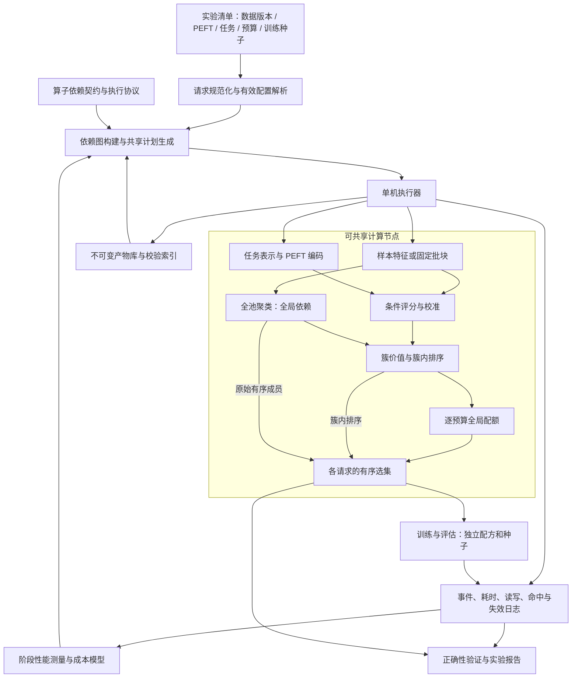
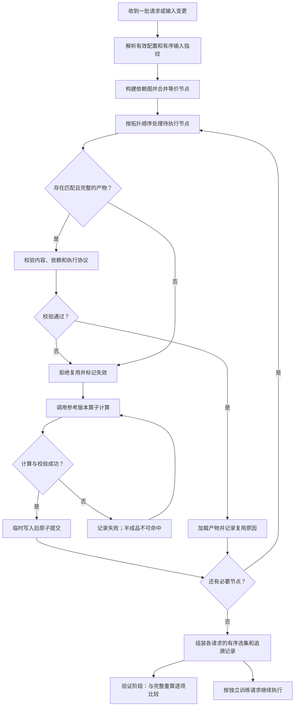

# 面向多配置参数高效微调的依赖感知复用与共享执行方法研究

> 项目副本说明：本文件保留完整研究计划；当前已实现范围见[实现与架构](implementation.md)。计划中的真实模型实验和研究结论尚未完成。

> 文档类型：毕业论文第二工作点研究方案  
> 版本：v0.1  
> 制定日期：2026-10-12  
> 计划周期：8 周，2026-10-12 至 2026-12-06；12 月上旬余下时间作为机动缓冲  
> 研究取向：优先形成完整、可复现、可答辩的工作，暂不以 GPU 数量限制范围  
> 状态：拟实施方案。下文的研究假设、预期贡献及效果均需实验验证，不代表已经完成或已经取得相应提升。

## 摘要

本工作承接第一工作点 PCU-Select，研究多配置、多任务、多预算数据选择实验中的重复计算和错误复用问题。PCU-Select 已通过条件效用模型复用跨 PEFT 的选择信号，但其多次应用仍包含重复评分、重复聚类、结果读写和输入变化后的重算。直接增加缓存无法充分解决问题：样本特征具有局部依赖，聚类与配额具有全局依赖；同一内容的不同顺序可能影响执行；预算变化也不保证选集嵌套。

本工作固定第一工作点的评分器和选数规则，建立中间产物的依赖契约与有效性判定，设计保持有序选集一致的增量复用方法，并面向已提交的实验批次生成共享执行计划。在参考执行协议固定的前提下，优化目标是降低整批请求的完成时间，避免无效重算和重复读写，同时使每个请求的输出与独立完整执行一致。

预期形成两项技术机制、一个单机原型系统和六组实验。主要研究内容为依赖正确性、增量失效和多请求共享执行；评分器内部计算共享与容量受限的物化策略，仅在性能测量证明必要且输出验证通过时纳入。界面、队列、数据库和日志是支撑功能，不单独作为创新点。

## 1. 研究背景与目标

### 1.1 场景

同一个候选数据池通常需要服务多个任务、多个 PEFT 配置和多个选数预算。例如：

- 保持任务不变，比较不同 LoRA rank、注入位置或 PEFT 家族；
- 保持 PEFT 和任务不变，将选数比例从 5% 调整到 10% 或 30%；
- 更新任务 sketch 后重新选择；
- 向候选池追加数据，或修改少量指令和回答；
- 对同一选集使用不同训练种子进行重复实验。

这些请求共享一部分计算，但各自产生独立结果。把每个请求作为完全独立的脚本执行，会重复计算；把整个流程统一缓存，又会在局部变更时造成过度失效，或在依赖不完整时错误复用。

### 1.2 总体目标

在保持 PCU-Select 选择行为的条件下，实现：

1. **正确复用**：任何命中的产物都满足当前请求的实际依赖。
2. **增量执行**：输入变化后，只重算在所声明粒度下失效的节点。
3. **共享执行**：已提交批次中的公共计算得到复用。
4. **可追溯验证**：每个结果都能追溯到数据、配置、模型和计算版本。
5. **可解释收益**：区分算法级复用、直接工程修复、共享计划及读写优化分别带来的收益。

不预设必须取得某个加速倍数。方法是否有效，由强基线、成本分解、消融和负面场景共同判断。

## 2. 与第一工作点的关系和边界

### 2.1 第一工作点的定位

PCU-Select 研究给定目标任务和 PEFT 配置时，如何通过可复用的条件效用模型选择训练子集。其主要资产包括：

- 样本特征及共享干预位点表示；
- 任务 sketch 与任务表示；
- 结构化 PEFT 编码；
- 多保真效用监督和训练后的评分器；
- 不确定性惩罚、聚类覆盖和配额选择；
- 下游训练评估流程。

已有定义见[第一工作点问题定义](../references/pcu-select/paper/Sections/03_problem_formulation.tex)、[方法正文](../references/pcu-select/paper/Sections/04_method.tex)和[实现设计](../references/pcu-select/docs/pcu_select_design.md)。

### 2.2 两个工作点的区别

| 维度 | 第一工作点：PCU-Select | 第二工作点：本方案 |
|---|---|---|
| 核心问题 | 给定任务和 PEFT，哪些数据值得训练 | 一批相关选数请求如何正确、低成本地完成 |
| 研究对象 | 条件效用、样本排序、训练子集 | 依赖关系、中间产物、失效传播、执行计划 |
| 方法主体 | 多保真学习、条件评分、聚类配额 | 依赖契约、增量失效、公共计算分解与复用 |
| 允许的近似 | 效用估计是近似的，通过下游效果验证 | 不允许缓存改变承诺保持的有序选集 |
| 主要评价 | 下游质量、选数成本、跨配置泛化 | 一致性、批次时间、重算量、读写和管理开销 |
| 核心产出 | 数据选择算法 | 保持算法行为的执行优化方法及系统 |

第二项固定第一项的评分器、选择规则和训练协议。改变评分网络、聚类算法、训练 token 数或选数预算产生的效果，不计入本工作的执行优化收益。

第一项已经实现的特征复用和评分器复用，是本工作的起点。第二项不能再次将这部分已有收益作为新增贡献。

### 2.3 毕业论文的整体组织

建议总题目：

> **面向参数高效微调的数据选择与实验执行优化研究**

两个主要研究章节可以分别命名为：

- **面向跨 PEFT 复用的条件数据效用建模与选择方法**；
- **面向多配置选数实验的依赖感知复用与共享执行方法**。

两章分别回答“如何获得适合目标配置的数据”和“如何高效且正确地反复执行相关实验”。

## 3. 相关研究与创新定位

### 3.1 直接相关研究

| 研究 | 已有贡献 | 本工作需要正面区分的内容 |
|---|---|---|
| [HELIX][R1] | 迭代机器学习中的中间结果复用、重算和选择性物化 | DAG、缓存和成本驱动重算本身不是新概念 |
| [LIMA，SIGMOD 2021][R2] | 细粒度依赖追踪、完整及部分复用 | 不能把细粒度 lineage 或成本/大小缓存打分单独作为创新 |
| [Nautilus，SIGMOD 2022][R3] | 演化训练数据上的特征物化、共享计算及模型选择优化 | 需要明确条件选数流程特有的全局耦合与请求结构 |
| [Materialization and Reuse Optimizations，SIGMOD 2022][R4] | 多条 ML 流水线的存储预算与复用计划优化 | 存储约束下保留哪些产物已有成熟问题定义 |
| [MEMPHIS，EDBT 2025][R5] | 多后端 lineage 复用和内存管理 | 本工作不扩展为通用 CPU/GPU/分布式缓存系统 |

上述文献用于界定研究边界，不意味着已经证明本方案具有独立发表的新颖性。最终贡献需要由实现、对照和实验结果支持。

### 3.2 避免只做工程集成的判断标准

本工作必须满足以下条件：

1. 定义清楚的输入、输出、正确性条件和成本目标。
2. 对 PCU 的局部计算与全局耦合计算建立可执行依赖规则。
3. 给出错误复用反例，解释普通整流程缓存或简单结果截取为何不足。
4. 设计明确的共享执行方法，而非只将脚本接入任务队列。
5. 与同粒度通用 DAG 缓存及手工共享方案比较。
6. 用消融、低共享场景和成本分解验证方法必要性。

以下内容只作为工程支撑，不单列为创新：登录和权限、页面布局、任务提交、日志浏览、普通文件哈希、数据库选型、通用任务队列、基础故障重试。

### 3.3 拟形成的技术贡献

| 编号 | 拟议贡献 | 必须提供的证据 |
|---|---|---|
| C1 | 面向条件选数流程的依赖契约和增量失效方法，区分样本/批块、条件、全池和预算依赖 | 正确性命题、反例、变更序列测试及增量实验 |
| C2 | 面向 PEFT × 任务 × 预算请求的计算分解与共享执行方法 | 强基线、执行次数分析、批次性能和消融 |
| C3 | 可追溯原型与覆盖变更、版本和故障的评估协议 | 可复现实验包、原始日志、端到端验证与失败边界 |

C1、C2 是两项核心技术机制；C3 是系统实现和实证支撑。成本感知物化和评分器塔共享属于可能增强 C2 的内容，不能在实验前保证其必要性。

## 4. 研究问题与形式化定义

### 4.1 研究问题

- **RQ1：** 不同输入和参数变化会使哪些产物失效？能否在输出不变的条件下减少重算？
- **RQ2：** 已知一批多配置、多任务、多预算请求，如何共享公共计算并缩短批次时间？
- **RQ3：** 与合理的通用 DAG 和手工共享方案相比，专门设计是否提供额外价值？
- **RQ4：** 方法在数据更新、低共享、版本切换和故障恢复场景中的收益与代价是什么？

### 4.2 请求定义

设请求批次为：

\[
\mathcal R=\{r_1,\ldots,r_m\}.
\]

一个选择请求至少包含：

\[
r=(D_v,t,p,B,\theta_s,\theta_c,\eta,e),
\]

其中：

- \(D_v\)：带内容版本和明确顺序的候选池；
- \(t\)：任务 sketch 及其表示协议；
- \(p\)：目标 PEFT 的有效配置；
- \(B\)：解析后的整数样本预算；
- \(\theta_s\)：评分器 checkpoint 与结构配置；
- \(\theta_c\)：可选校准头及启用状态；
- \(\eta\)：不确定性权重、聚类、配额、排序等选择参数；
- \(e\)：执行协议，包括实现版本、精度、批次和确定性设置。

训练请求在有序选集基础上额外包含实际训练配方、初始化/采样种子、模型版本及评估协议。选择请求和训练请求使用不同身份，不能将训练种子变化误认为新的 PCU 评分需求。

### 4.3 优化目标

设参考执行为 \(F\)，计划 \(\pi\) 下的优化执行为 \(F_\pi\)。主要目标为：

\[
\min_\pi T_{\mathrm{batch}}(\mathcal R,\pi),
\qquad
\text{s.t. }F_\pi(r_i)=F(r_i),\ \forall i.
\]

\(T_{\mathrm{batch}}\) 包含规划、校验、读取、计算、写入和适用实验中的失败恢复。性能实验以同一批次完成时间为主要指标。

若实测存在可信的容量约束，增加：

\[
\operatorname{Storage}_\pi(\tau)\le C,\quad\forall \tau.
\]

此时明确区分固定输入、可重建缓存、临时文件和必须保留的最终输出；容量约束作用在哪一类空间上必须对所有方法一致。

### 4.4 输出一致性的定义

本工作优先验证：

- scored IDs 与评分数组对齐；
- 聚类成员、簇价值和配额符合参考协议；
- 最终 **selected IDs 的有序列表相同**；
- 所消费的样本内容和训练有效配置相同。

“精确复用”表示不复用语义相似但内容或计算条件不同的结果，不无条件承诺跨硬件、跨库版本的浮点逐位一致。

严格模式以冻结的确定性执行协议为前提。数值容差用于诊断，不替代有序选集一致性；若某项优化改变了边界样本选择，不进入严格等价路径。

## 5. 当前实现基础与首周基线整理

### 5.1 已有基础

| 模块 | 已有能力 | 第二工作点需要补充的内容 |
|---|---|---|
| [FeatureCache](../references/pcu-select/src/pcu_select/features/cache.py) | Parquet 特征和站点梯度文件 | 内容与计算版本、不可变产物、完整性和索引一致性 |
| [run_apply](../references/pcu-select/src/pcu_select/pipeline/apply.py) | 读取特征、条件评分、选择 | 阶段拆分、合法命中、跨请求共享、独立结果路径 |
| [select](../references/pcu-select/src/pcu_select/selection/selector.py) | 聚类、簇价值、配额、取样 | 可复用的中间节点及明确顺序合同 |
| [实验公共流程](../references/pcu-select/scripts/experiments/_common.py) | 批量配置、训练评估、结果记录 | 同一候选域、避免重复评分、请求与训练身份分离 |
| [成本记录](../references/pcu-select/src/pcu_select/cost/accounting.py) | 阶段墙钟和基础成本记录 | CPU/GPU/I/O 区分、规划校验成本、命中与失效原因 |

### 5.2 首周需要统一的行为

当前实现已存在缓存，不能把“每次完全从原始数据重建”作为唯一效率基线。首周同时整理：

1. 选择流程与 dense score/排名评估使用同一候选域和 ID 顺序。
2. 重复评分、重复整读 Parquet 等直接开销。
3. 选集输出路径包含完整请求身份，避免不同预算覆盖同一文件。
4. 声明的 PEFT recipe 与 CLI 实际生效训练参数的对应关系。
5. 配额、排序、并列分数及预算解析的实际行为。
6. 特征提取、推理 batch 和数值执行协议。

规范修复单独记录版本和变更，不与缓存策略收益混算。优化方法与所有强基线共用整理后的参考实现。不能一边改变算法行为，一边声称是保持旧输出的纯执行优化。

### 5.3 测量项目

首周 profile 至少回答：

- 时间分别花在读取/转换、模型加载、评分、聚类、选择输出和训练的多少部分？
- 加入合理共享之后，还有多少重复计算？
- 缓存校验和写入成本是多少？
- 可重建产物总工作集是多少，是否存在现实的容量压力？
- 选择阶段在完整训练实验中的时间占比是多少？

## 6. 总体架构与执行流程

### 6.1 系统架构图



**图示说明：**

- 请求规范化将别名、默认值和覆盖参数解析成真实有效配置。
- 依赖契约决定“能否复用”；计划器决定“如何组织已合法的复用与执行”。
- 产物库是执行器之外的共享设施，不以实验目录名称作为有效性的唯一依据。
- 样本特征可局部复用，但全池聚类和逐预算配额显式标记为全局依赖。
- 训练和评估位于选择之后。不同训练种子可消费同一选集，但不能因此复用不同种子的训练结果。
- 日志反馈用于成本估计和实验解释，不直接改变第一项的效用模型。

### 6.2 增量复用与恢复流程图



**图示说明：**

- 局部变化不直接等于局部计算；失效范围由依赖图决定。
- 原始样本变化后，未受影响的合法特征/批块可以命中，但全池聚类需要重算。
- 失败重试应设置次数限制；图中的返回计算节点表示允许重试，不表示无限重试。
- 只有完整提交的产物可以被后续请求复用。
- 完整重算对照用于测试和实验验证，不要求每次正常服务都双跑，否则会抵消复用收益。

## 7. 技术机制一：依赖契约与精确增量复用

### 7.1 依赖层级

区分五类依赖：

1. **样本/批块级**：样本特征、固定批块评分。
2. **条件级**：任务表示、PEFT 编码及对应评分。
3. **全池级**：聚类、受全局成员影响的统计。
4. **预算/策略级**：配额及输出组装。
5. **训练级**：有序选集、实际训练 recipe、种子和评估。

系统只声明和实现有限的已知算子，不进行任意 Python 程序的自动依赖分析。

### 7.2 产物身份

建议产物规范包括：

```text
ArtifactSpec
  kind
  implementation_version
  dependencies[]              # 有序、带类型的父产物引用
  effective_config            # 实际影响本算子的配置
  execution_profile           # 精度、批次、环境等
  output_schema_version

ArtifactManifest
  artifact_key
  spec
  payload_paths
  payload_checksums
  shape_dtype_and_row_index
  created_at
  provenance                  # 来源请求，不参与不必要的重算
  commit_state
```

键的概念形式为：

\[
K_v=H(\text{算子版本},\text{父输入指纹},\text{有效参数},\text{执行协议}).
\]

使用稳定的规范序列化和完整内容摘要。计算依赖与来源记录分离：备注或请求名称变化不应导致模型计算失效；checkpoint 同路径内容替换则必须失效。

### 7.3 主要依赖表

| 产物 | 必须考虑的依赖 | 不应触发失效的典型变化 |
|---|---|---|
| 语义特征 | 样本内容、编码器与 tokenizer 修订、拼接/截断/归一化、提取版本与批次协议 | PEFT、任务和预算变化 |
| 模型统计与激活 | 内容、selector checkpoint、tokenizer、响应掩码、位点、hook/统计版本、数值协议 | 目标 PEFT、任务和预算变化 |
| 任务表示 | 有序 sketch 内容/特征、聚合规则、数值协议 | 候选池、PEFT、预算变化 |
| PEFT 编码 | 有效配置、位点空间、编码版本 | 候选池、任务、预算变化 |
| 原始 μ/σ | 有序特征批块、任务/PEFT 编码、评分器权重及结构文件、推理协议 | 预算、λ、聚类参数变化 |
| 校准后 μ | 原始输出、校准头及其所需输入、启用状态 | 预算、λ 变化 |
| 保守分数 q | μ、σ、λ、算术协议 | 预算变化 |
| 全池聚类 | 全部有序语义特征、N、有效 K、seed、batch_size、n_init、库与执行协议 | PEFT、任务、scorer、λ 和预算变化 |
| 簇价值 | q、聚类成员、top_pct、归约实现 | 预算、配额 alpha/floor 变化 |
| 簇内排序 | q、聚类成员与顺序、排序和并列规则 | 预算、配额参数变化 |
| 配额 | 全部簇价值/大小、解析后预算、alpha/floor、舍入和余量规则 | 下游训练种子变化 |
| 有序选集 | 配额、原始簇成员顺序、簇内排序、簇遍历顺序 | 下游训练种子变化 |
| 训练/评估 | 有序选集及内容、模型、有效配方、种子、评估数据与协议 | 仅完全相同任务的合法重试 |

### 7.4 四项关键正确性边界

#### 7.4.1 候选池身份必须保留顺序

同时保存成员摘要和有序摘要。成员摘要可以辅助识别增删，但聚类、并列排序和训练输入必须使用有序身份。

池重排时，独立样本特征可能仍可复用；不能直接复用旧聚类和最终有序选集。

#### 7.4.2 局部数据变化可能触发全局重算

当前 MiniBatchKMeans 对整个数据池执行 fit_predict，默认 K 也依赖 N。追加、删除、重排或修改语义特征后，严格模式重新聚类，并重新计算后续全局统计。

使用旧中心或 partial_fit 可以是另一种算法，但不属于本方案承诺的等价执行。

#### 7.4.3 预算变化不保证选集嵌套

使用当前配额函数已核验以下反例：

```text
4 个簇大小均为 100，alpha = 0.6
cluster_values =
[1.5403466579, 2.8518864520, 0.4410372420, 2.8464618469]

B = 7：配额 [2, 2, 1, 2]
B = 8：配额 [2, 3, 0, 3]
```

总预算增加时，第三个簇的配额反而减少。因此不能缓存一份大预算选集后截取前缀。

正确处理是复用 q、聚类、簇价值与完整簇内排序，对每个 B 重新运行原全局配额和输出组装。

#### 7.4.4 输出顺序不能由集合一致代替

当前实现对“整簇选入”和“部分选入”使用不同输出顺序。例如：

```text
原始成员 [a, b, c]，分数 [0.1, 0.9, 0.5]

选 2 条： [b, c]
选 3 条： [a, b, c]
```

缓存须同时保留原始成员顺序和排序序列。簇价值的 partition/mean 等归约方式也不应在等价优化中悄悄改变。

### 7.5 浮点与批次协议

第一版采用固定有序批块的评分缓存：

- 完整未变化批块可以复用；
- 追加导致旧尾块形状变化时，重算尾块和新块；
- 插入、删除、重排造成大量批块变化时，如实扩大失效范围；
- 不宣称“数学上逐样本独立”就意味着任意 batching 都逐位一致。

分开验证两种范围：

1. 给定固定特征快照的 apply 等价；
2. 从原始文本重新提取特征后的等价。

第二种还需要冻结语义编码批次、padding、截断和数值协议。MVP 先完成第一种，再支持可明确验证的原始数据变更路径。

评分器塔拆分或融合可能改变浮点执行方式，必须单独验证；未通过严格输出检查时，保留原计算路径。

### 7.6 正确性命题

**命题 A：依赖完整条件下的复用等价。**

将参考流程表示为 DAG。每个节点是完整父输入、有效参数和固定执行协议的确定函数。若满足：

- 所有影响输出的依赖都进入产物身份；
- 产物不可变并通过完整性校验；
- 假设内容摘要无碰撞，或额外核验依赖相等；
- 未命中节点调用相同参考函数；
- 保留输入顺序、批次、排序和归约行为；

则按拓扑顺序执行时，每个合法复用节点与完整重算节点一致，最终有序选集一致。

**证明思路：** 从输入节点开始，对拓扑顺序归纳。缓存命中时，其全部依赖与参考节点一致；缓存未命中时调用相同确定函数。两种情况下节点输出均一致，结论传播至最终输出。

**命题 B：预算扫描的复用边界。**

固定候选池、特征、条件、评分器、校准、λ、聚类参数，以及簇价值的 top_pct、归约实现和排序协议时，B 不影响评分、聚类、簇价值及簇内排序。重新执行预算相关的全局配额和保序输出，可以得到该预算完整重算的结果。

上述命题不证明自动找到了最小依赖集合，也不承诺全局最优重算计划或跨环境训练模型位级一致。

## 8. 技术机制二：多轴请求共享执行

### 8.1 请求分解

将一批请求按实际依赖分解为：

- 数据/特征共享组；
- 聚类共享组；
- PEFT—任务评分组；
- 选择策略组；
- 各预算配额与结果；
- 独立训练请求。

例如同一 pool、固定 λ 和聚类参数下：

\[
4\text{ PEFT}\times3\text{ tasks}\times3\text{ budgets}
=36\text{ selection requests}.
\]

结构上对应 1 次必要聚类、12 组评分、12 组簇价值/排序、36 组配额与输出。上述次数是依赖分析结果，不是预先承诺的实测加速倍数。

训练种子不进入这一选数身份。36 个请求加 3 个训练种子，可以产生 108 个训练任务，但不是 108 个不同评分任务。

### 8.2 最小共享计划算法

```text
输入：已提交请求批次 R、合法产物索引 A、依赖契约 K
输出：执行计划与各请求结果

1. 解析每个请求的默认值、覆盖参数和实际预算。
2. 按契约展开显式依赖节点。
3. 合并身份相同的节点，记录每个结果的消费者。
4. 检查已有产物的身份与完整性。
5. 对合法复用路径比较加载、重算及必要写入成本。
6. 生成遵守依赖的执行顺序。
7. 按计划执行需要计算的节点，包括各请求的配额与保序组装；提交不可变产物，更新消费者引用。
8. 在不影响后续请求的条件下释放临时结果。
9. 汇集各请求已生成的有序选集，输出追溯记录，不重复计算已完成节点。
```

所有计划策略都只使用同一份已提交批次。不能让新方法知道未来请求，而要求基线处理未知在线流。

### 8.3 评分器内部共享：条件性增强

当前三塔结构为：

\[
h_x=f_x(z_x),\quad h_p=f_p(z_p),\quad h_t=f_t(z_t).
\]

在固定评分器下：

- h_x 与目标 PEFT、任务无关；
- h_p 只依赖 PEFT 条件；
- h_t 只依赖任务条件；
- 条件融合及最终输出仍依赖具体组合。

可以比较直接评分、缓存完整评分和复用塔表示三种执行模板。不能将独立目标模型训练中的激活与这里冻结评分器的中间表示混为一谈。

启用条件：

1. profile 显示该部分有实际占比；
2. 共享读取和写入开销低于重复计算；
3. 对完整请求矩阵的数值和有序选集验证通过。

完整矩阵通过只能证明被测请求的输出一致。塔共享作为实验性执行模板单独报告；未经算子级等价证明或逐请求参考核验，不纳入命题 A 的保证，也不进入默认严格模式。默认严格模式仍采用固定批块的原评分算子。若实验依赖逐请求参考核验，其开销也须计入所报告的总成本。

### 8.4 成本选择与去重收益

对可选保留产物 v，设已有保留集合为 A：

\[
\Delta(v\mid A)=\widehat T(A)-\widehat T(A\cup\{v\}).
\]

时间估计应包含读取、写入和管理开销。每次选择后重新计算边际收益，避免把同一个共享祖先的计算成本重复计入多个后继。

最小版本使用少量执行模板和实测成本，无须通用优化器。若加入贪心物化，它只是待验证启发式，不声称全局最优、次模性或近似比。

### 8.5 容量优化的进入条件

理论数组大小示例：

- 300K 个样本的 float32 μ/σ，每个 PEFT—任务组合约 2.4 MB；
- 12 个组合约 28.8 MB；
- 300K × 256 的 float32 样本塔表示约 307.2 MB。

这些是按元素数量计算的示例，不是项目实测峰值。它们说明不同层级产物的大小和复用价值不同，也说明仅评分缓存可能没有现实容量压力。

只有真实工作集、历史版本或部署限制证明存在压力时，才增加容量实验。不能用极小的人造磁盘上限制造新策略优势。

## 9. 原型实现与交付接口

### 9.1 最小模块

| 模块 | 职责 | 最低交付 |
|---|---|---|
| request/schema | 规范化请求、解析有效配方和预算 | 不可歧义的实验 manifest |
| dependency | 依赖规则和产物身份 | 依赖图、命中/失效解释 |
| artifact_store | 不可变产物、checksum、原子提交 | 半成品不会被视为命中 |
| planner | 合并节点、选择执行模板与顺序 | 可检查的共享计划 |
| executor | 执行、提交、有限重试和阶段恢复 | 单机完整运行 |
| benchmark | 基线、变更轨迹、指标采集和作图 | 可复现实验包 |

以上是拟新增模块职责，不表示这些文件或接口已经实现。元数据可使用本地文件或轻量索引，避免首先建设数据库服务和分布式平台。

### 9.2 接口草案

```python
class ArtifactStore:
    def resolve(self, spec): ...
    def verify(self, ref): ...
    def commit(self, spec, payloads, metadata): ...

def normalize_requests(raw_requests): ...
def plan(requests, store, execution_policy): ...
def run(execution_plan): ...
def verify_against_reference(requests): ...
def explain_plan(execution_plan): ...
```

选择产物应一次性返回 scored IDs、μ、σ、q、cluster assignment、簇价值、配额和有序 selected IDs，避免评估代码为获取 dense score 再运行一次评分。

### 9.3 可靠提交与恢复

- 先写临时目录，再校验 payload 和索引，最后原子提交。
- manifest 标识完成状态；未完成产物不得进入命中集合。
- MVP 可采用单写者，之后按需要增加锁。
- 已完成阶段允许复用，失败阶段允许重跑。
- 不宣称故障下计算绝不重复，也不承诺训练内部每一步的恢复。

### 9.4 原始预算和有效训练配方

同时记录原始预算表达与 resolved_B。避免将比例和绝对样本数的边界值静默混用。

实际训练配置应先明确解析规则，再同时用于实验记录和相应条件编码。涉及修复已有配置冲突时，单独形成参考版本，不在性能实验中让不同方法执行不同配方。

## 10. 实验设计

### 10.1 公共设置

| 项目 | 主实验设置 |
|---|---|
| 模型与评分器 | 一个已有骨干、一个固定 scorer |
| 主候选池 | 100K；300K 做代表扩展 |
| PEFT | 4 个已支持稳定配置 |
| 任务 | 3 个已有任务，明确 sketch 与测试集隔离 |
| 预算 | 5%、10%、30% |
| 主选数工作负载 | 36 个不同 selection manifests |
| 请求顺序 | 固定清单，同时测试原始和简单分组顺序 |
| 主重复次数 | 配对 5 次完整批次；大规模扩展可 3 次 |
| 主要评价单位 | 完整工作负载，不将 DAG 节点当独立统计样本 |

不做 pool × task × PEFT × budget × seed × capacity 的全面组合。用主实验和针对性子实验分别回答问题。

### 10.2 对照方法

| 编号 | 方法 | 作用 |
|---|---|---|
| B0 | 现有缓存流程 | 展示真实工程起点，保留已有特征/task/backbone 复用 |
| B1 | 基础清理后的逐请求执行 | 排除重复评分、重复读取等直接修复收益 |
| B2 | 同粒度通用 DAG 缓存 | 验证专门方法是否超出合理公共计算复用 |
| B3 | 手工分组共享 | 检查简单按 pool/条件分组是否已经足够 |
| P | 完整拟议方法 | 依赖契约、共享计划及通过验证的成本选择 |

公平性要求：

- B1、B2、B3、P 共用参考算子、存储格式、批块及数值协议。
- B2 获得与 P 相同的依赖节点和合法性规则，不人为把它限制为粗粒度黑盒。
- 所有方法看到同一已提交批次，拥有相同输入、资源和初始缓存。
- 模型预加载、并行数、线程数、GPU 数及训练协议一致。
- 若研究缓存容量，B2/B3 至少包含 LRU 和简单成本/大小策略。
- 全部物化作为参考需计入写入/读取开销，不能直接称其为时间最优 oracle。
- 小规模可枚举计划用于诊断，但必须明确其规模和成本模型条件。

B2 可能取得与 P 接近的结果。此结果应真实报告；只有超过强基线的证据成立，才主张专门计划的额外价值。

### 10.3 E1：正确性与失效边界

**回答 RQ1。**

测试以下情况：

1. 同 ID 修改内容、同路径替换 checkpoint/sketch/calibration。
2. 候选池成员相同但顺序改变。
3. 预算、λ、top_pct、alpha 等参数分别改变。
4. 上述预算非嵌套与满簇保序反例。
5. 追加数据改变尾批形状，或跨越默认 K 的阈值。
6. 修改一个簇的统计可能导致所有配额变化。
7. 并列与近并列分数；非有限值按明确输入合同处理。
8. 写入半成品、索引错位和 checksum 失败。
9. 预算修改→sketch 修改→追加→删除→版本切换→回到历史版本。
10. 子集请求的选数域、dense score 域和评估域一致。

对每一步比较完整重算和增量执行，并断言应命中节点没有执行。

**指标：** 有序输出一致率、错误命中数、各节点命中/执行次数、失败类型。

**验收：** 定义范围内零错误命中、零有序选集不一致。性能提升不能抵消正确性失败。

### 10.4 E2：多配置矩阵共享收益

**回答 RQ2、RQ3。**

运行 4 PEFT × 3 tasks × 3 budgets 的 36 请求批次，对比 B0—B3 与 P。

**指标：**

- 批次总时间及选择阶段时间；
- 评分、聚类、排序和配额执行次数；
- 读取、转换、写入和规划时间；
- 读写字节、内存与存储峰值；
- 各请求延迟作为辅助指标。

**预期图表：** 方法总时间柱状图、阶段堆叠图、逻辑请求与实际算子次数表。

计算次数降低是机制证据，不自动等于相同比例的墙钟加速。

### 10.5 E3：输入变化后的增量执行

**回答 RQ1、RQ4。**

大型性能场景限定为：

| 场景 | 设置 | 核心检查 |
|---|---|---|
| 数据追加 | 追加 5% 样本 | 旧完整批块复用，尾块/新块处理，全池聚类重算 |
| 数据修改 | 修改或替换 1% 样本 | 内容失效及后继传播 |
| 任务变化 | 更换一个任务 sketch | 该任务分支失效，其他条件和聚类合法复用 |

每类使用代表性 12 请求子集。修改场景区分集中修改与分散修改；分散修改可能让大量批块失效，需要报告这一边界。

更多删除、重排和版本变化由 E1 覆盖，不全部扩展为大型耗时实验。

**指标：** 修改前后新增成本、重算范围、合法复用量、聚类占比和有序输出一致性。

**预期图表：** 失效传播图、阶段新增成本图、变更范围与时间关系图。

### 10.6 E4：共享计划与成本选择的独立价值

**回答 RQ3、RQ4。**

比较三类请求轨迹：

- 高共享：同 pool 的多条件、多预算扫描；
- 低共享：条件或输入频繁变化；
- 版本切换：scorer、sketch 或特征协议更新。

主要消融：

1. 固定顺序与分组/计划顺序；
2. 固定保留规则与成本选择；
3. 仅共享完整评分与可选塔表示共享；
4. 完整方法去掉增量复用或跨请求共享。

若容量问题成立，再采用约 0.25W、0.5W、1.0W 的工作集容量点，并同时报告实际 GB 和场景依据。所有可重建缓存采用相同约束，不能把本方法的索引、旧版本或临时文件隐去。

若容量问题不成立，本实验保留加载/重算选择、管理开销和低共享退化，不强行引入淘汰算法。

### 10.7 E5：下游一致性与端到端收益

**验证执行优化没有改变训练实验。**

建议训练量：

\[
2\text{ tasks}\times2\text{ PEFT}\times1\text{ budget}
\times2\text{ seeds}\times2\text{ paths}=16\text{ runs}.
\]

两条路径为参考与优化。所有 36 选集均进行严格对照，仅对代表性组合做训练验证；不需要对每种缓存策略重复全部训练。

检查有序样本、内容、训练有效配置、token/step 预算及任务指标。GPU 非确定性引起的训练数值差异与选择输入差异分开解释。

分别报告选择侧和端到端收益。若选择侧占总时间比例为 f、加速比为 s：

\[
S_{\mathrm{E2E}}=\frac{1}{(1-f)+f/s}.
\]

例如 f=0.1 时，完全消除选择成本的上限约为 1.11 倍；这是示例计算，不是项目测量。不能将第一项的选择侧收益或第二项的局部加速直接写成训练端到端加速。

### 10.8 E6：故障恢复与管理开销

**回答 RQ4。**

故障只覆盖两个位置：

- 产物写到一半；
- 长计算节点中断。

在相同逻辑故障点比较恢复，计入失败时间和重复工作。验证半成品不能命中、已提交结果可复用、恢复后输出相同。

额外测试小数据、单请求、低共享场景，报告 hash、manifest、校验、计划和写入的开销。

### 10.9 冷暖状态与成本账本

明确区分：

1. **首次准备**：从原始文本产生所需特征。
2. **派生产物冷启动**：基础模型和规定的初始特征已存在，派生缓存为空。
3. **产物热启动**：允许复用前一批留下的合法结果。
4. **进程状态**：新进程或模型预加载状态，单独记录。

新进程不代表操作系统页缓存已清空。无法保证物理冷 I/O 时如实标记，并随机化比较方法顺序。

每个节点至少记录：

```text
request_ids / artifact_key / operator / input_version
start / end / status / retry_count
read_time / compute_time / write_time / verify_time / plan_time
cpu_time / gpu_timing_or_allocated_device_time
read_bytes / write_bytes / peak_rss / peak_gpu_memory
cache_hit / invalidation_reason / eviction_reason
```

墙钟时间乘 GPU 数可以表示资源占用口径，但不能自动解释为 GPU 核心计算时间；CPU 聚类时间应单独呈现。

第一项已有离线成本对所有方法使用相同起点。若本实验实际重新构建资产，就计入对应准备阶段；不得一方免费获得、一方从零开始。

### 10.10 统计与复现

- 以完整批次/变更轨迹为统计单元，不把节点数当独立样本数。
- 主比较配对重复 5 次，记录方法顺序和机器状态。
- 300K 扩展可重复 3 次，报告中位数、范围或完整重复结果。
- 若计算区间，说明重采样单位和小样本限制。
- 将调试用工作负载与最终评估清单区分。
- 保留失败和不利场景，不能只挑高重复请求。
- 同时发布 manifest、版本、原始日志、聚合与作图命令。

## 11. 两个月实施计划

### 11.1 周计划

| 周次 | 日期 | 主要工作 | 必须交付 | 阶段关口 |
|---|---|---|---|---|
| 第 1 周 | 10/12—10/18 | 参考流程整理、依赖盘点、profile、工作集测量 | 冻结参考版本、36 请求清单、瓶颈和成本表 | 判断强复用后仍有何空间，是否存在真实容量压力 |
| 第 2 周 | 10/19—10/25 | 产物身份、校验、原子提交、基础增量执行 | 预算/配置变化及追加路径、有序一致性测试 | 正确性先成立 |
| 第 3 周 | 10/26—11/1 | 同粒度通用 DAG、手工共享基线、完整日志 | B1—B3 可运行、E1 测试集 | 判断专门计划是否超出直接工程修复 |
| 第 4 周 | 11/2—11/8 | 多轴共享计划、必要的成本模板、初步消融 | 完整方法第一版、小规模比较 | 收益超过噪声和管理成本；否则缩减策略 |
| 第 5 周 | 11/9—11/15 | 主矩阵、增量场景、冷暖产物实验 | E2/E3 主结果、阶段分解和失效图 | 冻结方法及主要参数 |
| 第 6 周 | 11/16—11/22 | 300K 扩展、E4/E6、16 次代表训练 | 扩展性、故障恢复、端到端证据 | 不新增研究方向 |
| 第 7 周 | 11/23—11/29 | 统计、消融解释、失败边界、论文初稿 | 方法与实验章节、主要图表 | 只补影响核心结论的缺口 |
| 第 8 周 | 11/30—12/6 | 关键复跑、复现包、论文与演示 | 完整研究交付包 | 余下时间用于返工缓冲 |

### 11.2 范围优先级

**必须完成：**

- 冻结参考行为与有效配置；
- 依赖契约、不可变产物与正确失效；
- 预算扫描和多条件请求共享；
- 同粒度通用 DAG 与手工共享强基线；
- E1—E3、必要消融、代表训练和恢复检查；
- 可复现日志、图表与论文。

**有证据再做：**

- 评分器塔级共享；
- 容量受限物化；
- 更复杂的执行顺序优化；
- 更多数据规模和版本轨迹。

**不进入八周主范围：**

- 分布式集群调度；
- 通用程序依赖自动分析；
- 跨 GPU 内存管理；
- 新 PEFT 或新的评分学习方法；
- 近似聚类和改变配额规则；
- 标签/评分器训练的增量学习；
- 大型前端、权限体系和完整多用户平台。

## 12. 风险、停止条件与调整方式

| 风险 | 识别时间 | 调整方式 |
|---|---|---|
| 主要成本在目标训练，选择占比很低 | 第 1 周 | 以选择服务/实验准备批次为主要对象，端到端收益按实测报告 |
| 派生缓存轻松全容纳 | 第 1 周 | 不做复杂淘汰，转向共享执行和增量正确性 |
| 普通 DAG/手工共享解决几乎全部重复 | 第 3 周 | 不主张专门调度算法优势，重新审查剩余可验证贡献 |
| 塔共享或批次变化改变选集 | 第 2—4 周 | 退回固定批块原计算路径，将改写列为未启用扩展 |
| 分散变更使大量批块失效 | E3 | 如实报告粒度边界，不声称与变更条数严格线性 |
| 校验和 I/O 成本抵消收益 | 第 4 周 | 调整保留层级，允许重算比加载更便宜的节点 |
| 效果仅来自重复评分等明显实现问题 | 第 3 周 | 将修复收益单列，所有强基线共享修复 |
| 后期范围膨胀 | 第 5 周后 | 停止新增模块，优先关键对照、复现和写作 |

继续条件不是必须达到某个预设倍数，而是在有实际意义的工作负载上，收益稳定超过运行噪声及系统自身开销，并能由机制消融解释。

若最终只优于旧脚本，却没有相对合理基线的新增方法价值，应收缩技术主张。不能靠重新命名通用缓存功能、隐藏管理成本或选择极端负载维持创新叙事。

## 13. 论文结构与最终验收

### 13.1 建议章节结构

1. 问题背景与现有方法边界；
2. 多配置选数请求与依赖语义；
3. 依赖契约、失效传播和正确性；
4. 多轴请求共享执行方法；
5. 原型系统实现；
6. 实验设置、强基线与主要结果；
7. 消融、成本分析及适用边界；
8. 本章小结与第一工作点的联系。

### 13.2 建议图表

- 系统总体架构图；
- 增量执行与产物提交流程图；
- 输入变更—失效范围示意图；
- 批次总耗时与阶段分解图；
- 逻辑请求数量与实际计算次数表；
- 追加/修改场景的重算成本图；
- 共享机制消融图；
- 选择侧与端到端收益对照；
- 故障恢复和管理开销表。

### 13.3 最终交付检查表

- [ ] 第一与第二工作点的贡献边界清楚。
- [ ] 参考实现、有效配置和数值协议冻结并可追溯。
- [ ] 所有适用请求的有序选集通过参考对照。
- [ ] 输入内容、版本、顺序及半成品不会被错误复用。
- [ ] 强基线获得同样节点粒度、底层实现和初始资产。
- [ ] 直接工程修复与专门机制收益分开报告。
- [ ] 规划、校验、读写、失败和准备成本未被遗漏。
- [ ] 选择请求和训练种子运行分别计数。
- [ ] 低共享、变更和失败场景均有结果。
- [ ] 结论不超出实际实验范围，不承诺通用最优或跨硬件位级一致。
- [ ] 运行清单、原始日志、分析与作图命令完整。
- [ ] 论文方法、实验和系统演示使用同一最终版本。

## 14. 可用于论文的贡献表述草案

以下文字需要在实验完成后，按实际成立的结论调整。

> **贡献一：** 针对参数高效微调数据选择中逐样本计算与全池耦合计算并存的特点，建立分层依赖契约与失效传播规则，设计保持有序选集一致的增量复用方法，并给出明确的正确性条件。

> **贡献二：** 针对 PEFT、任务和预算构成的多轴请求，设计公共计算分解与共享执行方法，在保留独立配额决策的同时复用评分、聚类和排序，并依据实测成本选择经过验证的复用路径。

> **贡献三：** 实现可追溯的原型系统，构建覆盖配置扫描、数据变更、版本切换和故障恢复的实验协议，评估输出正确性、执行效率及适用边界。

## 15. 资料与项目入口

### 15.1 相关研究

- **[R1] HELIX: Holistic Optimization for Accelerating Iterative Machine Learning.** [论文][R1]。用于理解跨迭代复用、重算与物化问题。
- **[R2] LIMA: Fine-grained Lineage Tracing and Reuse in Machine Learning Systems. SIGMOD 2021.** [论文][R2]。用于对照细粒度依赖与部分复用。
- **[R3] Nautilus: An Optimized System for Deep Transfer Learning over Evolving Training Datasets. SIGMOD 2022.** [论文][R3]。用于对照演化数据和共享模型选择执行。
- **[R4] Materialization and Reuse Optimizations for Production Data Science Pipelines. SIGMOD 2022.** [作者机构资料][R4]。用于对照多流水线物化与存储约束。
- **[R5] MEMPHIS: Holistic Lineage-based Reuse and Memory Management for Multi-backend ML Systems. EDBT 2025.** [论文][R5]。用于界定通用多后端复用已覆盖的范围。

### 15.2 项目入口

- [第一工作点研究方案](../references/pcu-select/docs/pcu_select_research_plan.md)
- [第一工作点实现设计](../references/pcu-select/docs/pcu_select_design.md)
- [既有实验设计](../references/pcu-select/docs/experiment_design.md)
- [项目论文上下文](../references/pcu-select/paper/project_context.md)
- [特征缓存](../references/pcu-select/src/pcu_select/features/cache.py)
- [应用流水线](../references/pcu-select/src/pcu_select/pipeline/apply.py)
- [评分器结构](../references/pcu-select/src/pcu_select/scorer/model.py)
- [评分推理](../references/pcu-select/src/pcu_select/scorer/inference.py)
- [聚类](../references/pcu-select/src/pcu_select/selection/cluster.py)
- [配额与有序选择](../references/pcu-select/src/pcu_select/selection/adaptive_quota.py)
- [实验公共流程](../references/pcu-select/scripts/experiments/_common.py)
- [成本记录](../references/pcu-select/src/pcu_select/cost/accounting.py)

[R1]: https://arxiv.org/abs/1812.05762
[R2]: https://mboehm7.github.io/resources/sigmod2021a_lima.pdf
[R3]: https://adalabucsd.github.io/papers/2022_Nautilus_SIGMOD.pdf
[R4]: https://www.dfki.de/web/forschung/projekte-publikationen/publikation/12706
[R5]: https://mboehm7.github.io/resources/edbt2025.pdf

